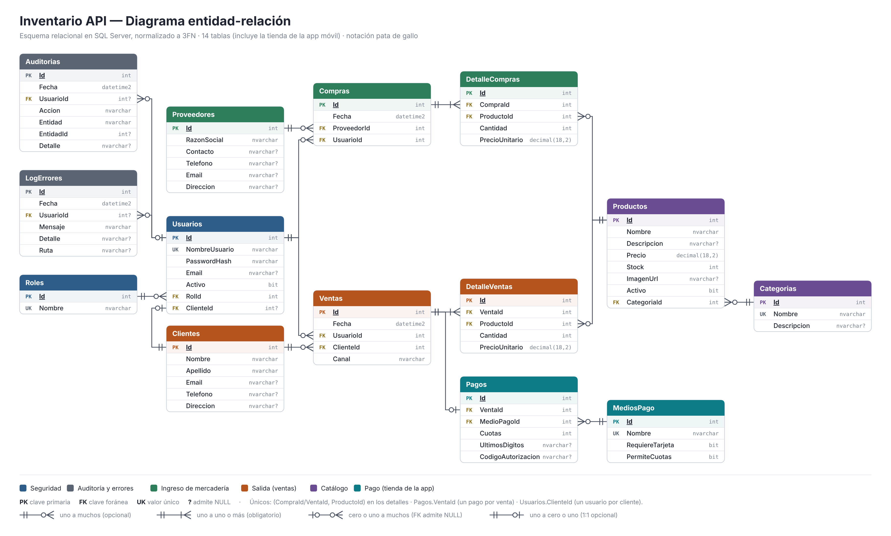

# Caja y Stock — Punto de venta con control de stock

Trabajo práctico de **Programación Web (TP6)**: frontend **Blazor WebAssembly standalone** orientado a escritorio, vinculado a la **API REST en ASP.NET Core (.NET 10)** desarrollada en el TP5. Funciona como el punto de venta de un supermercado: registra ventas en la caja, ingresos de mercadería y mantiene el stock actualizado, con reportes en PDF, control de acceso por roles y auditoría.

> **Este repositorio contiene dos trabajos que comparten la misma API y la misma base de datos:**
> - **TP6 Programación Web** (este documento): caja y stock en Blazor WebAssembly. Versión entregada: tag [`tp6-web-entrega`](../../releases/tag/tp6-web-entrega).
> - **TP6 Programación Móvil**: tienda con catálogo, carrito y pago simulado para Android en Blazor Hybrid (.NET MAUI). Ver **[README-movil.md](README-movil.md)**.
>
> Los cambios que necesitó la app móvil se agregaron a la API sin modificar lo que usa la web, así que ambos funcionan al mismo tiempo.

## Sistema publicado

| | Dirección |
|---|---|
| **Aplicación (frontend)** | https://cajaystockmaximiliano.netlify.app |
| **API (documentación Swagger)** | https://inventarioapi.runasp.net/swagger |

Ambos sitios funcionan con **HTTPS** (certificado SSL).

### Usuarios de prueba

| Usuario | Contraseña | Rol | Acceso |
|---|---|---|---|
| `admin` | `Admin123!` | Administrador | Caja, ventas, stock, ingreso de mercadería, usuarios, auditoría y reportes |
| `cajero1` | `Cajero123!` | Cajero | Caja, sus propias ventas y consulta de stock |
| `cajero2` | `Cajero123!` | Cajero | Igual que `cajero1` |

El sistema publicado tiene cargados datos de demostración: 23 productos en 5 categorías, 3 proveedores, 5 clientes y unas 40 ventas de las últimas semanas. Hay un producto sin stock y dos con stock bajo para ver cómo se resaltan.

## Funcionalidades

**Punto de venta (Admin y Cajero)**
- Búsqueda de productos por nombre (Enter agrega el primero al ticket).
- Ticket con cantidades editables, cliente opcional (por defecto *Consumidor Final*) y total.
- No permite vender más de lo que hay en stock: se controla en pantalla y, de forma definitiva, en la API.
- El precio de venta lo toma la API desde la base de datos, no lo envía el navegador.
- Al cobrar muestra el ticket, que se puede imprimir.

**Ingreso de mercadería (solo Admin)**
- Selección de proveedor (o alta de uno nuevo), productos, cantidades y costo unitario.
- Al confirmar, el stock se suma y queda registrada la compra con fecha, proveedor y usuario.

**Stock**
- Existencias actualizadas, con indicador de stock bajo (5 o menos) y sin stock.
- El administrador da de alta y edita productos (con imagen) y categorías.

**Reportes PDF (solo Admin)**
- Stock actual valorizado; ventas por período (totales, ticket promedio, productos más vendidos, detalle); ingresos de mercadería por período.
- Se ven en pantalla, se descargan o se envían por correo como adjunto.

**Usuarios y roles (solo Admin)**
- Alta de usuarios con su rol, cambio de rol y activación/desactivación.
- El registro público solo crea cajeros; no se puede quitar el rol ni desactivar al último administrador.

**Auditoría y registro de errores (solo Admin)**
- Cada alta, modificación y baja queda registrada automáticamente con usuario, fecha y detalle del cambio (por ejemplo `Stock: 10 -> 8`). También los ingresos al sistema, los intentos fallidos y la generación o envío de reportes.
- Cualquier error no controlado se guarda en la tabla `LogErrores` con ruta, usuario y detalle técnico; el usuario ve un mensaje claro con el número de error. Desde la pantalla de auditoría se puede generar un error de prueba para verificarlo.

## Arquitectura

```
TP INVENTARIO/
├── InventarioApi/                → API: controladores, middleware de errores, servicios (PDF, correo), Program.cs
│   └── InventarioApi.slnx        → solución (abre los 5 proyectos)
├── InventarioApi.Domain/         → entidades y clases de paginado
├── InventarioApi.Infrastructure/ → AppDbContext (con auditoría), migraciones, JWT, datos iniciales
├── InventarioApi.Web/            → frontend Blazor WebAssembly standalone (TP web)
└── InventarioApi.Movil/          → app Android .NET MAUI Blazor Hybrid (TP móvil)
```

El frontend es una aplicación independiente que corre en el navegador y se comunica con la API por HTTPS, enviando el token JWT en cada pedido.

## Base de datos

SQL Server, **normalizada hasta tercera forma normal**. Diagrama entidad-relación (también disponible editable en `diagrama-er.drawio`):



- **1FN:** todos los valores son atómicos; las compras y ventas usan tablas de detalle en lugar de listas.
- **2FN:** todas las tablas tienen clave primaria simple, por lo que ningún atributo depende de una parte de la clave.
- **3FN:**
  - El total de compras y ventas no se guarda: se calcula a partir de sus detalles.
  - Los roles están en su propia tabla (`Roles`), referenciada por `Usuarios.RolId`.
  - El `PrecioUnitario` de cada detalle no es redundante: es el precio vigente en el momento de la operación y depende de la línea, no del producto.
  - `Producto.Stock` es una redundancia controlada que se mantiene dentro de transacciones, para validar ventas al instante.
- Para la tienda de la app móvil se agregaron las tablas `MediosPago` y `Pagos`, el rol `Cliente`, la columna `Ventas.Canal` (Caja o App) y `Usuarios.ClienteId`. El detalle de cómo respetan la 3FN está en [README-movil.md](README-movil.md#base-de-datos).
- Índices únicos: nombre de usuario, nombre de rol, nombre de categoría, el par (venta/compra, producto) en los detalles, `Pagos.VentaId` y `Usuarios.ClienteId`.

## Seguridad

- **Autenticación JWT:** `POST /api/auth/login` devuelve el token. El frontend lo guarda en el navegador y lo envía en el header `Authorization: Bearer ...`.
- **Contraseñas** guardadas con hash BCrypt.
- **Autorización por roles** (`Admin`, `Cajero`) en la API con `[Authorize(Roles = "...")]` y en el frontend ocultando menús y protegiendo rutas.
- **Concurrencia:** al vender o ingresar mercadería se bloquea la fila del producto durante la transacción, así dos cajas no pueden vender a la vez la última unidad.
- **CORS** permisivo, como pide la consigna.

## Despliegue

- **API y base de datos:** MonsterASP.NET (plan gratuito), con HTTPS activado.
- **Frontend:** Netlify (plan gratuito), con HTTPS automático.
- **Correo:** SMTP de Gmail con contraseña de aplicación. Como alternativa, la API admite el servicio Brevo por configuración (`Correo:Proveedor`).

## Cómo ejecutarlo localmente

1. Abrir `InventarioApi/InventarioApi.slnx` en Visual Studio 2026 (carga de trabajo "Desarrollo de ASP.NET y web").
2. Configurar la cadena de conexión a SQL Server en `InventarioApi/appsettings.json`.
3. En la Consola del Administrador de paquetes (proyecto predeterminado `InventarioApi.Infrastructure`):
   ```
   Update-Database -StartupProject InventarioApi
   ```
4. Configurar como proyectos de inicio `InventarioApi` e `InventarioApi.Web` (click derecho en la solución → Configurar proyectos de inicio) y ejecutar con **F5**.
5. Al primer arranque se crea el usuario `admin` / `Admin123!` (configurable en la sección `AdminInicial`).
6. Para el envío de correos, cargar la cuenta en los secretos de usuario del proyecto `InventarioApi` (click derecho → Administrar secretos de usuario):
   ```json
   { "Correo": { "Usuario": "cuenta@gmail.com", "Password": "contraseña de aplicación", "Remitente": "cuenta@gmail.com" } }
   ```

## Tecnologías

.NET 10 · ASP.NET Core Web API · Entity Framework Core · SQL Server · Blazor WebAssembly · JWT · BCrypt · QuestPDF · MailKit · Swagger

## Autores

Trabajo práctico desarrollado por **Arrieta Maximiliano** y **Marco Gonzáles** — 2026.
